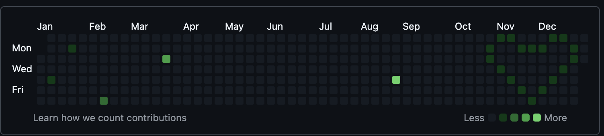

# DrawCommitMosaic

Create dated, empty Git commits for contribution-calendar experiments.

通过指定日期生成 Git 空提交，探索 GitHub 贡献日历上的图案。支持单日期、多日期文件和原始的 2019 年爱心示例。

**默认只预览；加上 `--apply` 才会创建本地提交。** 脚本本身不执行拉取或推送。

## 示例效果



爱心效果示例，由项目作者提供截图。实际显示效果会受到日期、时区和其他贡献记录影响；历史示例的日期见下方说明。

## 环境要求

运行只需要 Bash 3.2 或更新版本和 Git，兼容 macOS 自带 Bash；不需要 Python、Node.js、GitHub CLI 或访问令牌。开发检查另需 Make、ShellCheck 和 shfmt，见[贡献指南](CONTRIBUTING.md)。

## 快速开始

```bash
git clone https://github.com/lucifly/DrawCommitMosaic.git
cd DrawCommitMosaic

# 为图案创建独立的目标仓库，并先预览。
git init ../mosaic-art
./scripts/draw-commits.sh --repo ../mosaic-art '2026-01-04T12:00:00+08:00'
```

实际生成前，为目标仓库设置自己的 Git 身份。以下姓名和邮箱是占位值，需替换；希望关联 GitHub 时，应使用账号已关联的邮箱或 GitHub 提供的 noreply 邮箱。

```bash
git -C ../mosaic-art config user.name 'Your Name'
git -C ../mosaic-art config user.email 'your-verified-email@example.com'

./scripts/draw-commits.sh --repo ../mosaic-art --apply '2026-01-04T12:00:00+08:00'
git -C ../mosaic-art log --format=fuller
```

每个日期对应一个新空提交，author date 和 committer date 使用相同时间。已有提交和跟踪文件内容保持原样；不会创建占位文件，也不会暂存其他文件。

## 批量与爱心示例

```bash
# 多个日期按传入顺序处理，默认只预览。
./scripts/draw-commits.sh --repo ../mosaic-art \
  '2026-01-04T12:00:00+08:00' '2026-01-05T12:00:00+08:00'

# 预览历史爱心日期，确认后再执行。
./drawHeart.sh --repo ../mosaic-art
./drawHeart.sh --repo ../mosaic-art --apply
```

[examples/heart.dates](examples/heart.dates) 保留了原脚本的 18 个日期，位于 **2019 年 10 月至 12 月**。它不会自动映射到当前年份，也不表示当前年度会显示爱心。

自定义文件每行一个 Git 可识别的日期，推荐带时区的 ISO 8601。支持空行、以 `#` 开头的注释、CRLF 和没有结尾换行的最后一行；不支持行尾注释。

```text
# my-pattern.dates
2026-01-04T12:00:00+08:00
2026-01-05T12:00:00+08:00
```

```bash
./scripts/draw-commits.sh --repo ../mosaic-art --dates-file my-pattern.dates
./scripts/draw-commits.sh --repo ../mosaic-art --dates-file my-pattern.dates --apply
```

重复日期和重复执行会产生额外提交，不会去重。脚本按输入顺序创建提交，不自动排序，也不依据文本或图片计算新图案。

## 命令参数

| 参数 | 含义 |
| --- | --- |
| `DATE [DATE ...]` | 一个或多个 Git 可识别的日期；含空格时必须加引号 |
| `--repo DIR` | 目标工作区；默认是调用命令时所在的仓库 |
| `--dates-file FILE` | 从文件读入日期，与位置日期参数互斥 |
| `--message TEXT` | 为每个提交设置同一消息；默认是 `mosaic: DATE` |
| `--dry-run` | 仅预览，也是默认行为 |
| `--apply` | 创建本地空提交 |
| `-h` / `--help` | 显示帮助 |

`--apply` 和 `--dry-run` 同时出现时，后出现的选项生效。执行前会校验整批日期；应用还要求目标处于分支上、具有有效的 Git 身份配置，并且没有已暂存、未暂存或未跟踪的变动。Git 忽略的文件不属于此检查范围。

Git hooks 与提交签名遵循目标仓库的正常配置。运行中发生 hook、签名或磁盘错误时会停止；此前成功创建的提交会保留。检查目标日志后再决定是否重试整批，以免生成重复记录。

## 旧入口兼容

两个原文件名仍然可用，路径相对脚本自身定位，也可从其他目录调用：

```bash
./shellpullpush.sh --repo ../mosaic-art 'Nov 10 23:04:57 2019 -0700'
./drawHeart.sh --repo ../mosaic-art
```

`--repo` 未指定时，目标仍是调用者当前所在的 Git 仓库。`shellpullpush.sh` 名称为兼容保留，现已不再执行 pull、push 或 amend；两个入口均默认为预览。

## GitHub 展示

本地生成成功不等于贡献日历一定显示相同图案。GitHub 会按邮箱关联、仓库是否为 fork、默认分支等条件统计；日期、时区与现有贡献也会影响最终显示。参见 [GitHub 贡献统计说明](https://docs.github.com/en/account-and-profile/reference/profile-contributions-reference)和[缺失贡献排查](https://docs.github.com/en/account-and-profile/how-tos/contribution-settings/troubleshooting-missing-contributions)。

检查本地结果和目标远端后，再自行推送。脚本不会设置远端、修改默认分支或要求提供 GitHub 凭据。

## 项目结构

```text
scripts/draw-commits.sh        核心命令
examples/heart.dates           历史爱心日期
docs/images/heart-example.png  爱心效果截图
tests/test_draw_commits.sh     临时仓库集成测试
drawHeart.sh                   爱心示例兼容入口
shellpullpush.sh               单日期兼容入口
Makefile                       格式、lint 和测试入口
.github/                       CI 与反馈模板
```

运行 `make check` 执行静态检查、格式检查和集成测试；`make format` 应用 Shell 格式。完整开发步骤见[贡献指南](CONTRIBUTING.md)，行为变化见[变更记录](CHANGELOG.md)。

## 许可证

[MIT License](LICENSE)，Copyright © 2026 lucifly。
